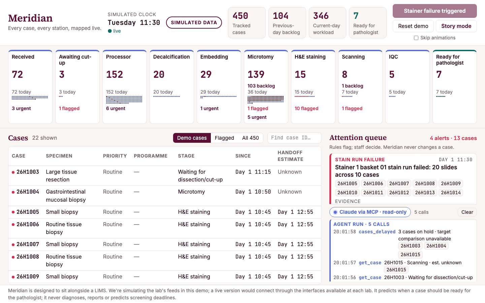
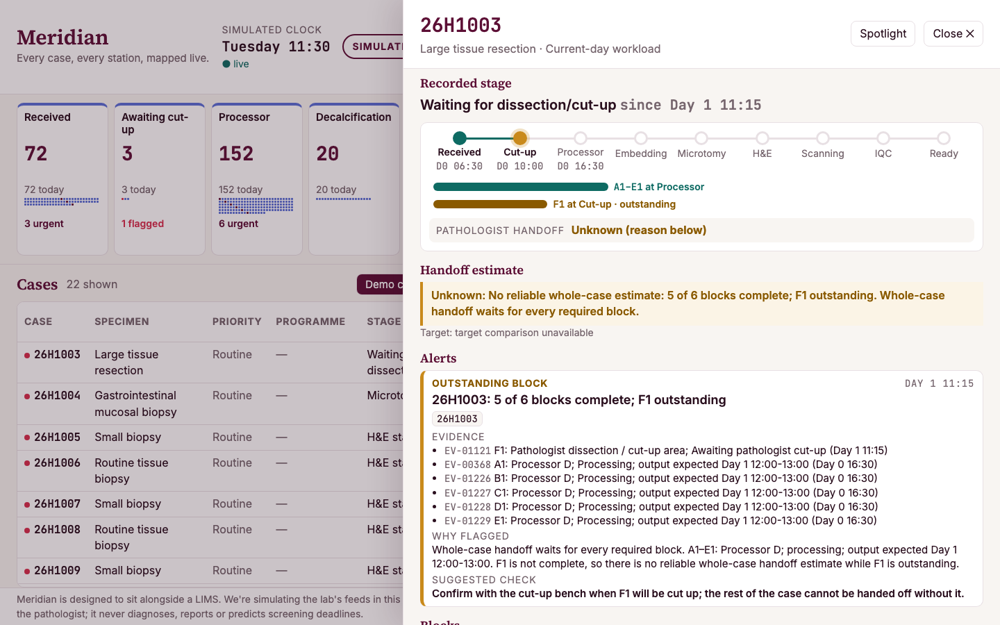
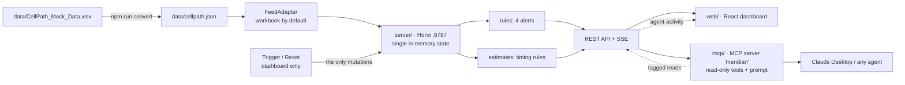

# Meridian

**Every case, every station, mapped live.**

Meridian is an open, AI-ready layer designed to sit alongside a histology lab's LIMS. It shows every case, block and station live, flags problems the moment the data shows them, estimates when each case will be ready for the pathologist (or says "unknown" and why), and gives any AI agent a read-only endpoint to query the lab through MCP. Rules decide, the AI explains, scientists act.

> ⚠️ **Simulated data: not connected to a real lab.** Meridian runs on a fictional, expert-elicited dataset with illustrative timings ([how it was made](docs/DATA_PROVENANCE.md)). It predicts lab preparation and handoff to the pathologist only. It never diagnoses, interprets tissue, reports cases, or predicts reporting times or screening-programme deadlines.

Built for the Science Works *Reinvent the Wheel* hackathon (London, 16–18 October 2026) by team **Block Party**: Victoria (histology lab lead, domain) and Manthan (build).



## What we reinvented: sample tracking and the LIMS

1. **What the software is for.** A LIMS is the lab's digital record of every sample: when it arrived and each step it has passed through. In histology, tissue is cut into blocks, processed overnight, set in wax, sliced into slides, stained, scanned and quality-checked before a pathologist sees it. That is up to 10 stations, with many blocks and slides per case.
2. **What wasn't working** (from Victoria's experience; LIMS capabilities vary):
   - the record isn't a live view, so finding what's holding a case means checking several screens and walking the lab;
   - errors (a missing block, missing levels, a failed stain run, a missing scan) are often found down the line;
   - one equipment failure silently delays many cases;
   - no AI agent can ask the system anything.
3. **What Meridian makes better:**
   - one live map of every case, block and station;
   - evidence-backed alerts, each with what, evidence, why and the suggested staff check;
   - honest handoff estimates;
   - an **open event model** and an **MCP endpoint for agentic control**, read-only by design.

It answers the brief's "disconnected tools or closed data" with an open event model, `GET /api/events` and a `FeedAdapter`; and "no end points for agentic control" with the `meridian` MCP server and its `shift_handover` workflow.

## What it does

| | |
|---|---|
| **Live lab map** | 10 stage lanes with one dot per case; counts reconcile to 450 = 104 previous-day backlog + 346 current-day; click a lane to filter |
| **Four deterministic alerts** | Outstanding block (26H1003: F1 still at cut-up) · protocol mismatch (26H1004: 1 of 3 levels) · stain-run failure (20 slides, 10 cases, after the trigger) · missing scan event (26H1015) |
| **Handoff estimates** | Remaining steps × the workbook's timing rules, inside working windows; components, active vs wall-clock time, and assumptions shown; "unknown" with a reason when data is missing (e.g. decalcification) |
| **Incident replay** | The recorded H&E incident (basket `H&E-BASKET-01` failed at 10:45, acknowledged, reloaded, 30-minute repeat run started 11:05) is held back and replayed from the dashboard; Server-Sent Events push it to every screen; the 10 affected cases are flagged and their estimates include the repeat run. "Reset demo" restores the start state |
| **Case drawer** | A flight-tracker journey bar, blocks shown separately (A1–E1 at the processor, F1 at cut-up), levels, recorded timeline, estimate breakdown |
| **MCP + agent console** | Claude Desktop (or any MCP client) calls `get_case`, `list_alerts`, `cases_delayed` and the `shift_handover` prompt; each call appears live in the dashboard's console with a one-way beam into the case it read |
| **Story mode** | Plays the pitch arc on live state (no recorded numbers); arrow keys advance |



## Quick start (Node 20+)

```bash
git clone https://github.com/Manthanbhanushali010/meridian-lab.git
cd meridian-lab
npm install
npm run dev        # API on http://localhost:8787, dashboard on http://localhost:5173
npm test           # 149 acceptance tests
```

Open http://localhost:5173. Try **Trigger stainer basket failure**, click a case, then **Reset demo**. **Story mode** plays the whole arc.

| Command | What it does |
|---|---|
| `npm run dev` | API and dashboard together, with hot reload |
| `npm test` | All acceptance tests (Vitest) |
| `npm run mcp` | The MCP server on stdio. For Claude Desktop use the absolute-path config in [docs/MCP_SETUP.md](docs/MCP_SETUP.md) |
| `npm run convert` | Rebuild `data/cellpath.json` from the workbook (already committed) |
| `npm run export:hf` | Rebuild the open dataset CSVs in `hf_dataset/` |
| `VITE_FX=off npm run dev` | Plain dashboard with every animation off (the stage fallback) |

Tool versions are pinned so the project runs on Node 20.11 (Vite 6, Vitest 3, TypeScript 5.9). `npm audit` reports advisories in Vitest's own dependencies (tinypool, @vitest/mocker). They affect only the local test runner, never the app. On Node 22+ you can move to Vitest 5 to clear them.

## Architecture



- **One source of truth.** Only `server/` holds state. The dashboard and the MCP server both read the same HTTP API, so they can never disagree.
- **Deterministic first.** Code computes every count, alert and estimate. The model only explains tool results. An overclaim guard scans alert, estimate and tool output for banned claims (diagnosis, reporting times, screening deadlines, "misplaced").
- **Read-only AI.** MCP tools are annotated read-only. Agent activity is logged without touching case state, and a test proves it.

## MCP: an endpoint for agentic control

See **[docs/MCP_SETUP.md](docs/MCP_SETUP.md)** for the Claude Desktop config (absolute paths), MCP Inspector commands (the on-stage backup), the four demo questions and troubleshooting.

- **Tools:** `get_case(case_id)`, `list_alerts(kind?, case_id?)`, `cases_delayed(programme?, priority?)`.
- **Prompt:** `shift_handover` makes the agent call `list_alerts` → `get_case` for each affected case → `cases_delayed`, then write a sourced brief: open alerts with evidence IDs, cases at risk, unknowns, staff checks, and what is not in scope. `mode=brief` returns the same brief built by code.
- **Resource:** `meridian://overview`.

## Open event model: bring your own LIMS export

See **[docs/EVENT_MODEL.md](docs/EVENT_MODEL.md)**:
- the entities (case → block → slide, basket, station, event) and the 36 event types;
- the paged `GET /api/events`;
- the `FeedAdapter` interface;
- an **IEEE XES / OCEL 2.0 mapping**;
- step-by-step "bring your own LIMS export" (`MERIDIAN_DATA=/path/to/export.json npm run dev`).

## Data

- **[docs/DATA_PROVENANCE.md](docs/DATA_PROVENANCE.md)**: how the synthetic, expert-elicited dataset was built and validated, the evidence base, and its limitations.
- `hf_dataset/`: the open dataset (five CSVs, CC BY 4.0) with generic equipment names and demo notes removed. See its [dataset card](hf_dataset/README.md).
- Volumes: 450 cases · 712 blocks · 426 slides · 1,253 events · 22 detailed demo cases. All identifiers, devices and staff initials (AA/BB) are fictional.

## Tests

`npm test` runs **149 tests in 16 files**, all passing at submission. They cover:
- data reconciliation and validation (counts, links, ordering, clock, the single staged event);
- each alert's IDs and evidence;
- the trigger (exactly 20 slides / 10 cases, once, three times in a row after reset);
- estimates (26H1003 and 26H1016 unknown, 26H1018 and 26H2345 ready, the 30-minute repeat run from 11:05 after the incident);
- targets;
- every API route, SSE, the events API and the feed adapter;
- MCP tools, prompt and resource over an in-memory MCP client;
- agent activity never mutating state;
- the dataset export and the overclaim guard.

## Safety boundaries

- Histopathology lab preparation only, up to handoff to the pathologist. No diagnosis, tissue interpretation, reporting, patient management or screening-deadline prediction.
- No invented events, times or causes. Missing data returns "unknown" or "not enough information" with the reason.
- A missing scan record never proves a slide is misplaced: "missing scan event; check the slide location or scan record."
- Decalcification is a normal stage: no alert and no invented duration.
- Urgency comes only from the recorded priority.
- Delay is claimed only against `config/targets.json`; otherwise "target comparison unavailable".
- AI tools are read-only; only a person pressing the dashboard's demo controls changes state.
- Fictional IDs only, generic equipment labels, and "SIMULATED DATA" always visible.

## Built with

| | Licence |
|---|---|
| [Hono](https://github.com/honojs/hono) + @hono/node-server: API and Server-Sent Events | MIT |
| [MCP TypeScript SDK](https://github.com/modelcontextprotocol/typescript-sdk) + [zod](https://github.com/colinhacks/zod): the `meridian` MCP server | MIT |
| [MCP Inspector](https://github.com/modelcontextprotocol/inspector): testing the tools (via npx) | MIT |
| [React](https://react.dev) + [Vite](https://vitejs.dev): dashboard | MIT |
| [Motion](https://motion.dev) (formerly Framer Motion): lab river, ripple, spotlight, agent beam, Story mode | MIT |
| [NumberFlow](https://number-flow.barvian.me): rolling counts and times | MIT |
| [Tailwind CSS](https://tailwindcss.com) | MIT |
| [Vitest](https://vitest.dev): tests | MIT |
| [SheetJS](https://sheetjs.com) (from cdn.sheetjs.com): workbook conversion | Apache-2.0 |
| tsx, concurrently, TypeScript | MIT / MIT / Apache-2.0 |
| [Matt Pocock's skills](https://github.com/mattpocock/skills) (`/tdd` and others) and [Impeccable](https://github.com/pbakaus/impeccable) (design): agent skills used while building; not shipped in this repo | see each repo |
| Built with [Claude Code](https://claude.com/claude-code) | |

Third-party repos consulted for reference are logged in [external/REGISTRY.md](external/REGISTRY.md); no code was copied from them.

## Approved wording

> Meridian is designed to sit alongside a LIMS. The agent reads case events from the lab's workflow systems. We're simulating those feeds in this demo; a live version would connect through the interfaces available at each lab, with lab-approved access control, information-governance review and audit.

## Licence

Code: MIT, see [LICENSE](LICENSE). Dataset in `hf_dataset/`: CC BY 4.0.
